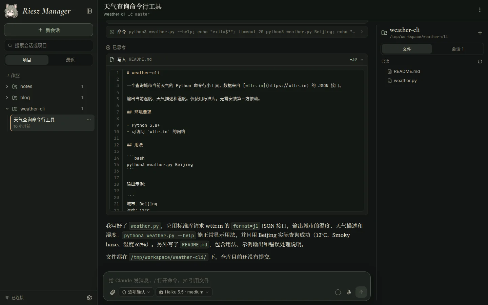
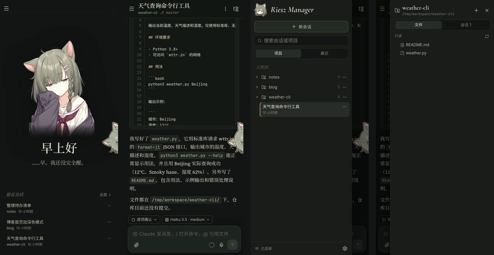

# Riesz Manager

在浏览器里查看和操控一台机器上的所有 Claude Code 会话，界面风格类似 Claude 客户端，支持桌面和手机（可安装为 PWA）。

文档：[中文](https://rieszprojects.github.io/RieszManager/) · [English](https://rieszprojects.github.io/RieszManager/en/)

<p align="center"></p>





## 功能

- **会话总览**：读取本机 `~/.claude` 中的全部会话，按项目（工作区下的一级文件夹）归类；实时显示哪些会话正在运行、在等待确认。
- **会话管理**：支持重命名、归档（默认隐藏，可在设置里显示）、拖动排序（保存在服务器，各设备一致）、分叉为新会话、复制终端恢复命令。
- **完整的对话视图**：支持 Markdown、代码高亮、数学公式、工具调用卡片（命令输出、文件 diff、待办清单、子代理、网页抓取、MCP 工具等）、思考块、上下文压缩记录；图片点开全屏查看，可缩放、滑动切换。
- **在网页里继续对话**：随时发送消息（运行中发送会排队，在合适时机送达）；`Esc` 中断当前任务并立即发送排队消息；`/` 打开斜杠命令列表；`@` 引用项目文件；`↑`/`↓` 调出历史输入；`Shift+Tab` 切换权限模式；切换模型和推理强度（默认沿用 Claude Code 自己的设置）；发送按钮旁的小圆圈显示上下文已用多少、离 Claude Code 自动压缩还有多远（悬停或点按查看数字）。
- **会话之间协作**：网页里运行的会话能和其他 Claude Code 会话互发消息；「保持运行」让会话空闲时也不关闭、runner 重启后自动回来；会话还能在 Bash 里用 `rieszctl session new` 开一个由 Riesz Manager 托管的新会话（和在网页上开的一样），再用 `send`、`wait` 分派任务、取回结果。
- **交互式确认**：工具权限请求、`AskUserQuestion` 提问、计划审批都在网页中直接处理。
- **附件与语音**：粘贴或拖放图片和文件；语音输入（配置 OpenAI 兼容的转写接口，或使用浏览器自带的语音识别）。
- **终端里的会话**：实时旁观，也可以直接发消息——会话空闲时会自动转到这里继续（终端里的那个 Claude 进程会退出）；正在工作时消息先排队，等它空闲后自动送达。也可以分叉一份副本继续。
- **项目面板**：查看项目下的会话和文件树（只读，带 git 状态标记），在线预览代码、Markdown、图片、PDF，HTML 文件会在隔离的沙箱里渲染成网页预览。
- **推送通知**：Claude 等你确认、向你提问、完成运行超过 1 分钟的任务或进程意外中断时，推送到手机和电脑，应用关着也能收到；你正在看的会话不推送。推送走浏览器标准的 Web Push，每个部署用自己生成的密钥直接发送，不依赖任何第三方账号。
- **莉思玩偶（可选）**：在“设置 → 通用”中打开后，看板娘“莉思”会从屏幕角落（手机上是屏幕边缘）探出头来：可以按住捏她，点她查看 Claude 套餐的用量和重置时间，或者选一条“快捷短语”填进输入框（短语在设置里编辑，所有设备共用）；会话等待确认或用量快满时她会提醒你。关闭后相关代码和图片都不会加载。灵感来自 DeepSeek Harness 的插件 [DeepSeek Balance Whale Widget](https://github.com/MeteorNOX/DeepSeek-Balance-Whale-Widget)。
- **手机端与 PWA**：首页列出最近会话；在屏幕任意位置横滑打开左右抽屉（右滑打开会话列表、左滑打开项目面板）；返回键先关闭打开的窗口；支持安装为 PWA 到主屏幕，切回前台时自动更新到新版本。

## 文档

完整的文档是一个网页站点（中文和英文），源文件在 [`docs/`](docs/) 目录，发布在 GitHub Pages：**[https://rieszprojects.github.io/RieszManager/](https://rieszprojects.github.io/RieszManager/)**。

- [快速上手](https://rieszprojects.github.io/RieszManager/quickstart.html)：在一台 Linux 机器上装好并在本机打开，完成第一次对话。
- [使用指南](https://rieszprojects.github.io/RieszManager/guide.html)：每个界面和功能的用法，包括推送通知、手机使用和莉思玩偶。
- [部署教程](https://rieszprojects.github.io/RieszManager/deploy.html)：组件、配置、HTTPS、账号安全、升级、备份、排错和全部环境变量。

English documentation: [https://rieszprojects.github.io/RieszManager/en/](https://rieszprojects.github.io/RieszManager/en/)

## 架构

```
浏览器 ──https──▶ (TLS 终端：Cloudflare Tunnel / Caddy / …)
                         │
                         ▼  127.0.0.1:RIESZ_PORT
               ┌──────── gateway (nginx) ────────┐      Docker
               │   /            /api, /ws        │
               ▼                ▼                │
          frontend          backend (Django ASGI)│
         (静态 SPA)          登录 / TOTP / 代理  │
                                 │ Unix socket   │
               └─────────────────┼───────────────┘
                                 ▼
                    runner（宿主机，systemd 用户服务）
                    读取 ~/.claude，浏览工作区文件，
                    以 stream-json 协议驱动 claude 进程
```

Claude Code 必须运行在宿主机的真实环境中（你的工具链、凭据、文件权限），所以与会话打交道的部分是一个很小的宿主机守护进程 **runner**；它只监听一个仅当前用户可访问的 Unix socket，并要求令牌认证。前端、后端和网关都在 Docker 中运行，后端是唯一能访问 runner 的组件。

| 目录 | 说明 |
| --- | --- |
| `runner/` | 宿主机守护进程（Python + aiohttp） |
| `backend/` | Django 后端：认证、两步验证、REST/WebSocket 代理、推送通知、语音转写 |
| `frontend/` | Vite + React + MUI 前端，PWA |
| `nginx/` | 网关配置 |
| `rieszctl` | 安装与运维脚本 |

## 快速开始

需要：Linux、已登录的 Claude Code（`claude` 可用）、Python ≥ 3.10、Docker 与 Docker Compose v2。

```bash
git clone https://github.com/RieszProjects/RieszManager.git && cd RieszManager
./rieszctl init              # 生成 .env（随机密钥和临时密码）
$EDITOR .env                 # 至少设置 WORKSPACE_ROOT 和 RIESZ_PUBLIC_ORIGIN
./rieszctl runner install    # 安装并启动宿主机 runner
./rieszctl up                # 构建并启动容器
./rieszctl status            # 检查各组件
```

然后在 TLS 反向代理（推荐 Cloudflare Tunnel）里把你的域名指向 `http://127.0.0.1:18573`。完整步骤、HTTPS 方案、升级与排错见[部署教程](https://rieszprojects.github.io/RieszManager/deploy.html)。

## 常用命令

```bash
./rieszctl hash-password     # 生成密码哈希，写入 RIESZ_PASSWORD_HASH
./rieszctl reset-totp        # 丢失验证器时关闭两步验证
./rieszctl revoke-sessions   # 让所有设备重新登录
./rieszctl runner logs       # 查看 runner 日志
./rieszctl logs backend      # 查看容器日志
./rieszctl session --help    # 从其他会话开新的托管会话、发消息、等结果
```

## 安全

- **认证与访问控制**：没有注册功能，账号密码写在服务器的 `.env` 中；支持 TOTP 两步验证、恢复码、登录限流、设备管理与登录记录。
- **网络暴露面**：网关默认只监听本机，需要放在 TLS 终端（如 Cloudflare Tunnel、Caddy）后面提供访问。
- **进程与组件隔离**：runner 只监听仅当前用户可访问的 Unix socket 并校验令牌，后端是唯一能访问 runner 的组件。
- **文件与预览安全**：项目文件以只读方式提供；HTML 文件在隔离的沙箱里渲染预览。
- **权限提醒**：任何能登录的人都能以宿主机用户身份让 Claude 执行命令，因此请务必使用强密码并开启两步验证。

更多安全细节请参见[部署教程：安全说明](https://rieszprojects.github.io/RieszManager/deploy.html#security)。

## 开发

文档站的页面正文在 `docs/_src/zh/` 和 `docs/_src/en/`，修改后执行 `python3 docs/_src/build.py` 重新生成 `docs/` 下的页面。

三个部分各开一个终端，在仓库根目录下执行：

```bash
# runner
cd runner && python3 -m venv .venv && .venv/bin/pip install -r requirements.txt
.venv/bin/python -m riesz_runner --env-file ../.env

# backend（RIESZ_ENV_FILE 指向一个开发用 .env，其中 RUNNER_CONTAINER_SOCKET 指向 runner 的 socket）
cd backend && python3 -m venv .venv && .venv/bin/pip install -r requirements.txt
RIESZ_ENV_FILE=../.env.dev .venv/bin/python manage.py migrate
RIESZ_ENV_FILE=../.env.dev .venv/bin/uvicorn riesz.asgi:application --port 18601 --lifespan on

# frontend（/api 与 /ws 代理到 RIESZ_DEV_BACKEND，默认 http://127.0.0.1:18601）
cd frontend && npm install && npm run dev
```

开发服务器（`npm run dev`）不启用 Service Worker，推送通知和应用更新需要用 `npm run build && npx vite preview` 在 `localhost` 上测试。

## 许可

本项目以 [Apache License 2.0](LICENSE) 发布。

莉思玩偶的捏捏音效剪自 [Freesound](https://freesound.org/) 上以 CC0（公有领域）发布的一段录音，来源见 [`frontend/public/doll/sounds/CREDITS.md`](frontend/public/doll/sounds/CREDITS.md)。
