# 使用教程

RieszManager（界面上显示为 Riesz）是一个自部署的网页应用，用来在电脑或手机浏览器里查看和操控一台机器上的全部 Claude Code 会话。网页里的会话直接对应机器上 `~/.claude` 中的会话记录，在网页里继续的会话也可以回到终端用 `claude --resume <会话 ID>` 接着使用。

本教程面向已经完成部署、准备在日常工作中使用 RieszManager 的用户。如果你还没有部署服务，请先阅读 [部署指南](deployment.md)。

## 目录

- [快速上手](#快速上手)
- [登录](#登录)
- [认识界面](#认识界面)
- [开始一个会话](#开始一个会话)
- [查看对话](#查看对话)
- [发送消息与使用输入框](#发送消息与使用输入框)
- [权限模式、模型与推理强度](#权限模式模型与推理强度)
- [处理确认和提问](#处理确认和提问)
- [查看上下文用量](#查看上下文用量)
- [管理会话与项目](#管理会话与项目)
- [接管终端里的会话](#接管终端里的会话)
- [浏览与预览项目文件](#浏览与预览项目文件)
- [开启推送通知](#开启推送通知)
- [使用莉思玩偶](#使用莉思玩偶)
- [在手机上使用](#在手机上使用)
- [设置与账号安全](#设置与账号安全)
- [快捷键汇总](#快捷键汇总)
- [常见问题](#常见问题)

## 快速上手

下面用一次最常见的流程，带你走完从登录到日常使用的主要步骤：

1. **登录账号**：打开网页，输入部署者在服务器 `.env` 中配置的「用户名」和「密码」登录；可勾选「在此设备上保持登录」。详见 [登录](#登录)。
2. **认识界面布局**：界面分为左、中、右三栏——左边栏切换「项目」和「最近」会话，中间是对话区和输入框，右边面板查看项目的「文件」和「会话」。详见 [认识界面](#认识界面)。
3. **在项目里新建会话并发消息**：点击左边栏的「新会话」并在弹出的列表里「选择项目」（或直接点击左边栏的项目名），在底部输入框输入第一条消息并按回车发送，会话即创建成功。详见 [开始一个会话](#开始一个会话) 和 [发送消息与使用输入框](#发送消息与使用输入框)。
4. **处理一次权限确认**：当 Claude 需要执行命令或编辑文件时，对话底部会出现确认卡片，点击「允许」即可继续（也可选择「允许，且不再询问 …」或「拒绝」）。详见 [处理确认和提问](#处理确认和提问)。
5. **在右边面板查看项目文件**：点击右边面板的「文件」标签查看带 git 状态标记的文件树，点击任意文件即可预览代码、Markdown、图片、PDF 或渲染后的 HTML 网页。详见 [浏览与预览项目文件](#浏览与预览项目文件)。
6. **在手机上开启推送通知**：在手机上打开 Riesz，向右滑出会话列表，点左下角的齿轮按钮，在「设置 → 通用 → 推送通知」打开开关。这样即使关掉应用，也能在 Claude 等你确认或任务完成时收到通知。详见 [开启推送通知](#开启推送通知) 和 [在手机上使用](#在手机上使用)。

## 登录

RieszManager 没有注册功能，账号和密码由部署者写在服务器的 `.env` 文件中。

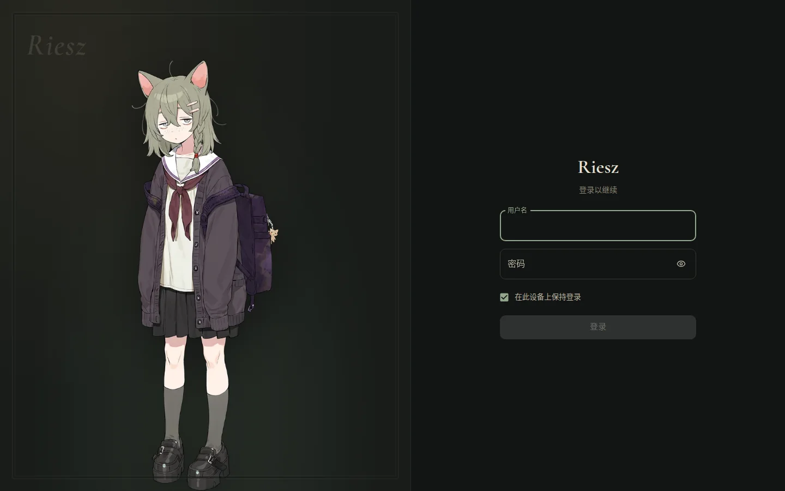

1. 在登录页输入「用户名」和「密码」。勾选「在此设备上保持登录」后，关闭浏览器也不会退出登录。
2. 如果账号启用了两步验证，输入密码后还需要输入验证器（如 Google Authenticator、1Password、Aegis 等）里的 6 位验证码。
3. 如果丢失了验证器，可以点击「使用恢复码」，输入一个恢复码登录（每个恢复码只能使用一次）。

注意：连续输错密码或验证码会被暂时锁定，以防止暴力破解。

## 认识界面

登录后进入主界面，整体分为左、中、右三个区域：

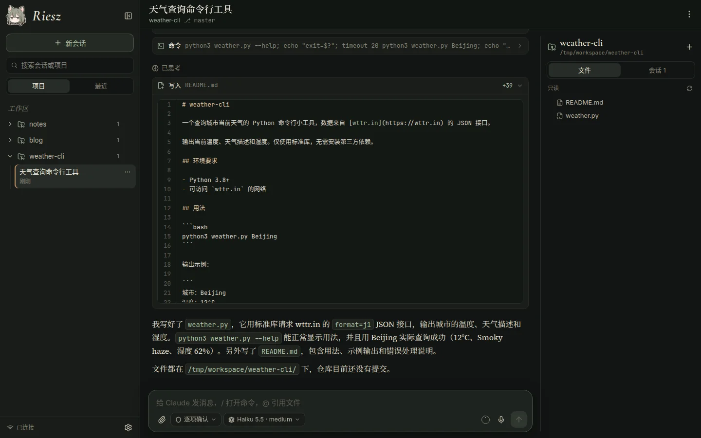

- **左边栏**：
  - 顶部是 Riesz 标志（点击回到首页）和「新会话」按钮；点击标志右侧的按钮可以将左边栏收起成窄条（窄条上保留回到首页、展开、新会话和设置按钮）。
  - 下方是「搜索会话或项目」搜索框，以及「项目」和「最近」两个标签。
  - 「项目」标签：工作区（部署时设置的文件夹，例如 `~/workspace`）下的每个一级文件夹就是一个项目。点击项目名进入项目页（可在此开启新会话）；展开项目会列出该项目下的会话，点击会话即可进入。
  - 「最近」标签：所有会话按时间排列（今天 / 昨天 / 更早…）。正在运行的会话会单独放在最上面的「运行中」一组，并用分隔线隔开。会话旁带有绿色小圆点表示该会话正在运行。
  - 左下角显示连接状态（「已连接」）和设置按钮（齿轮）。
- **中间对话区**：顶部显示会话标题、所在项目和 git 分支，右上角「⋯」是会话菜单；最下方是消息输入框。
- **右边项目面板**：包含「文件」和「会话」两个标签。「文件」是当前项目的文件树（只读，带 git 状态标记），「会话」列出当前项目的全部会话。当屏幕不够宽时，右边面板会自动收起，可点击标题栏右侧的按钮打开。

## 开始一个会话

你可以通过以下两种方式开始一个新会话：

1. **方式一**：点击左边栏顶部的「新会话」，在弹出的列表里「选择项目」，进入项目页后输入第一条消息。
2. **方式二**：在左边栏直接点击项目名进入项目页，在下方输入框里输入消息。

发出第一条消息时，会话才会真正创建。新会话默认沿用你在 Claude Code 里设置的模型和推理强度。

## 查看对话

对话区完整渲染 Claude Code 的对话内容与运行状态：

- **富文本与多媒体**：支持 Markdown、代码高亮、数学公式、可折叠的思考过程、上下文压缩记录以及图片展示。
- **工具调用卡片**：命令和输出、文件修改的 diff、新写入的文件、待办清单、子代理、网页抓取、MCP 工具等操作都会显示为卡片。点击卡片标题可以展开或收起详情。
- **运行状态提示**：Claude 工作时，底部会出现一个带看板娘「莉思」小人的状态行（如「斟酌中」「思索中」），并显示已用时间；等待命令或子代理时，会显示「等待命令执行完成」「等待子代理完成」等提示，后台任务也会在此显示。
- **异常终止提示**：如果会话上次运行没有正常结束，会显示「已终止 · 上次运行没有完成」。
- **历史消息加载**：往上滚动会自动加载更早的消息；滚动离开底部后，右下角会出现回到底部的按钮。

## 发送消息与使用输入框

输入框支持消息排队、斜杠命令、文件引用、附件上传和语音输入。输入草稿会自动保存在当前设备上，切换会话或刷新页面都不会丢失。

- **发送与换行**：在电脑上按回车发送，按 Shift+回车换行；在手机上回车是换行，点击发送按钮发送。
- **消息排队与撤回**：你可以随时发送消息。Claude 正在工作时发出的消息会进入排队状态，在合适的时机送达；排队中的消息可以点击「撤回」。
- **中断任务**：按 Esc（或点击停止按钮）可中断当前任务；如果有排队的消息，中断后会立即发送它们（「中断当前任务并立即发送」）。此功能只对在网页里运行的会话有效，终端里运行的会话需要在终端里中断。
- **历史输入**：当光标在输入框最开头时按 ↑ 可调出以前输入过的消息，光标在最末尾时按 ↓ 往回翻。

### 斜杠命令与文件引用

- **斜杠命令**：在输入框输入 `/` 打开斜杠命令列表（即 Claude Code 的斜杠命令，包括 `/compact`、`/context`、`/usage`、`/clear` 等，以及你安装的技能和插件命令）。使用方向键选择，按 Tab 补全，按回车确认，按 Esc 关闭。

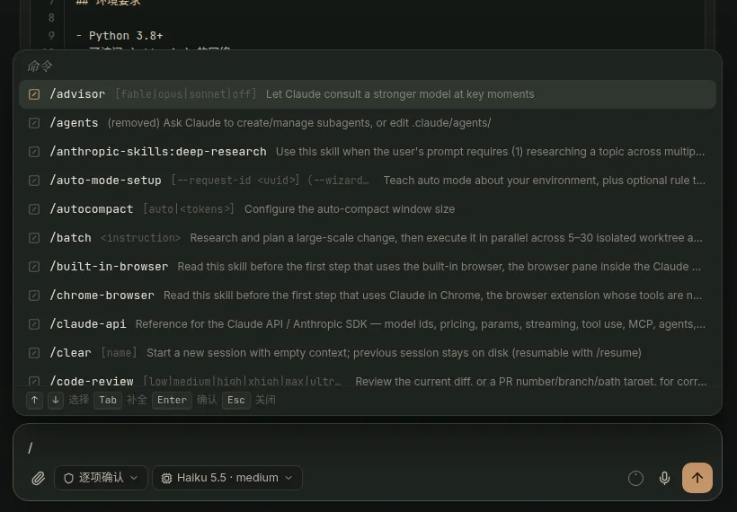

- **引用文件**：输入 `@` 可引用项目里的文件。在弹出的文件列表中选中后会将路径插入输入框，Claude 会读取该文件。

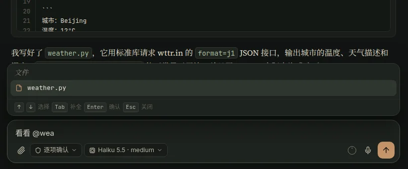

### 附件与语音输入

- **添加附件**：点击输入框旁的回形针按钮，或者直接把图片、文件粘贴或拖进输入框（拖入时会显示「松开以添加附件」）。
- **语音输入**：点击麦克风按钮开始录音，再点一次停止，识别出的文字会填进输入框。如果部署者配置了 OpenAI 兼容的转写接口，会使用服务器转写；否则使用浏览器自带的语音识别。注意：麦克风只能在 HTTPS 页面下使用。

## 权限模式、模型与推理强度

输入框底部有两个设置按钮（在手机上位于输入框上方），这些设置会随会话保存——会话结束后再恢复时，会沿用上次的模型、推理强度和权限模式。

### 权限模式

点击权限模式按钮（或按快捷键 Shift+Tab 依次切换），可在以下模式间选择：

- 「逐项确认」：每次编辑和命令都请求许可。
- 「自动接受编辑」：文件编辑自动通过，命令仍需确认。
- 「计划模式」：只读调研，先给出计划。
- 「自动模式」：由分类器判断风险，安全操作自动执行。
- 「跳过权限」：不再询问任何权限（危险；只有部署者开启后才会出现）。

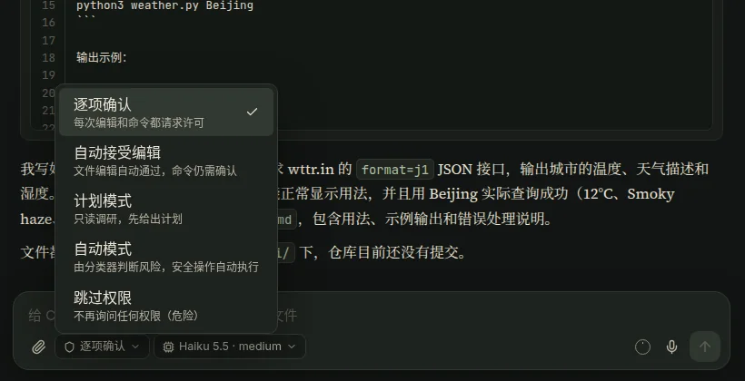

### 模型与推理强度

点击模型按钮，上方列出 Claude Code 支持的模型，下面一排可选择推理强度（`low` / `medium` / `high` / `xhigh` / `max`，具体可选值取决于所选模型）。

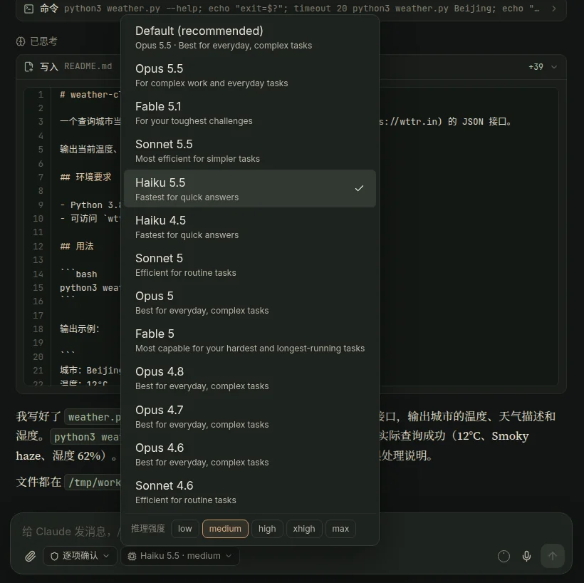

## 处理确认和提问

在对话过程中，Claude 可能会请求操作许可、向你提问或请你审批计划：

- **权限确认**：当 Claude 要执行需要许可的操作时，对话底部会出现确认卡片（例如「允许 命令?」），你可以选择：
  - 「允许」：允许本次操作。
  - 「允许，且不再询问 …」：把这条规则加入本地设置，以后同类操作不再询问。
  - 「拒绝」：拒绝本次操作（可以附上理由）。

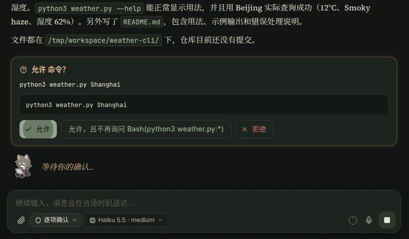

- **回答提问**：当 Claude 用提问工具向你提问时，底部会出现选项卡片。你可以直接点击选项（多选题可以选多个），或者在「其他（自行输入）」里写自己的回答，然后点击「提交回答」；也可以点击「跳过」。

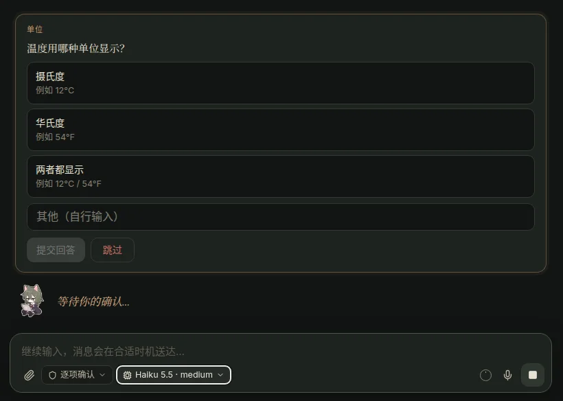

- **审批计划**：在「计划模式」下，Claude 写好计划后会请你审批计划。

## 查看上下文用量

发送按钮旁边的小圆圈实时显示当前会话已经用掉多少上下文：

- 圆圈内部按已用比例填色，用量达到 70% 以上时变橙色，达到 90% 以上时变红色。
- 将鼠标悬停在小圆圈上（手机上点一下），会显示详细数字，例如「上下文已用 3%」「24k / 967k tokens」「距离自动压缩还有 943k」。这里的比例是相对于 Claude Code 自动压缩的触发点计算的（即窗口大小减去自动压缩预留的缓冲区）。
- 刚刚压缩过的会话会显示「刚压缩过上下文」。

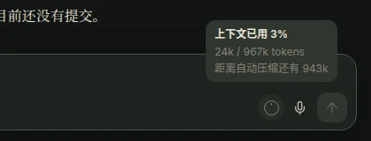

## 管理会话与项目

点击对话区标题栏右上角的「⋯」按钮，可以打开会话菜单：

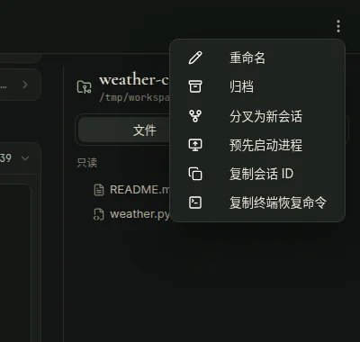

- **重命名**：修改会话名称（也可以直接点击标题栏里的会话标题改名）。
- **归档**：将会话标记为已归档。
- **分叉为新会话**：复制一份当前会话从这里继续，原会话不受影响。
- **复制会话 ID**：复制当前会话的 ID。
- **复制终端恢复命令**：复制 `claude --resume <ID>` 命令，方便回到终端里接着用。
- **进程控制**：如果会话当前由网页托管运行，菜单里会有「结束后台进程」（结束后，下次发消息时会自动恢复）；如果会话还没启动，则会有「预先启动进程」。

此外，左右两侧会话列表里每个会话右边的「⋯」菜单也提供「重命名」「归档」「复制会话 ID」操作。

### 归档与排序

- **查看与取消归档**：归档只是一个标记。归档后的会话和项目默认隐藏，在「设置 → 通用 → 显示已归档的会话和项目」中打开开关后即可看到（带有「已归档」标签），也可以对它们执行「取消归档」。点击左边栏项目右边的「⋯」可以归档整个项目。
- **拖动排序**：左边栏的项目可以拖动重新排列；右边面板「会话」标签里的会话也可以拖动排序。排序顺序保存在服务器上，所有设备保持一致。
- **自动清理**：工作区里已经删除的文件夹不会再显示在项目列表中。

## 接管终端里的会话

在机器终端里直接运行的 `claude` 会话也会出现在 RieszManager 的会话列表里（旁边带绿点表示正在运行）。你可以点进会话实时旁观对话，也可以在网页里接管它：

- **直接发消息接管**：
  - 如果该终端会话正处于空闲状态，输入框会提示「发送后，这个终端会话会转到这里继续」。发出消息后，会话会自动转到网页里继续，终端里原有的 `claude` 进程会退出。
  - 如果该终端会话正在工作，发出的消息会先排队（输入框提示「终端里的会话正在工作，消息会在它空闲后送达」），等它空闲后自动送达并转到网页。
- **通过菜单接管或分叉**：你也可以在会话菜单里点击「从终端转到这里」，或者点击「分叉为新会话」复制一份会话在网页里另起一支。

## 浏览与预览项目文件

右边面板的「文件」标签展示当前项目的文件树（只读），并带有修改、新增等 git 状态标记。

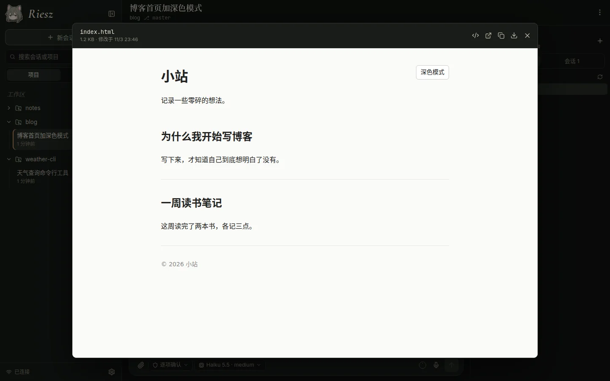

点击文件即可打开预览窗口，支持多种文件格式与操作：

- **代码、文档与媒体**：代码文件带语法高亮和行号（可切换「自动换行」）；Markdown 文件默认渲染显示（可切换「查看源码」）；支持直接预览图片和 PDF。预览窗口还提供「复制内容」和「下载」按钮。
- **HTML 网页预览**：HTML 文件会直接渲染成网页（脚本和外部资源都能运行），你可以切换「查看源码」或点击「在新标签页打开」。预览网页运行在隔离的沙箱里，读不到 RieszManager 的登录状态和数据；页面里的相对链接（如 CSS、图片、其他页面）会自动指向同一项目里的文件。

## 开启推送通知

开启推送通知后，即使应用完全关掉，你也能及时收到会话状态提醒。

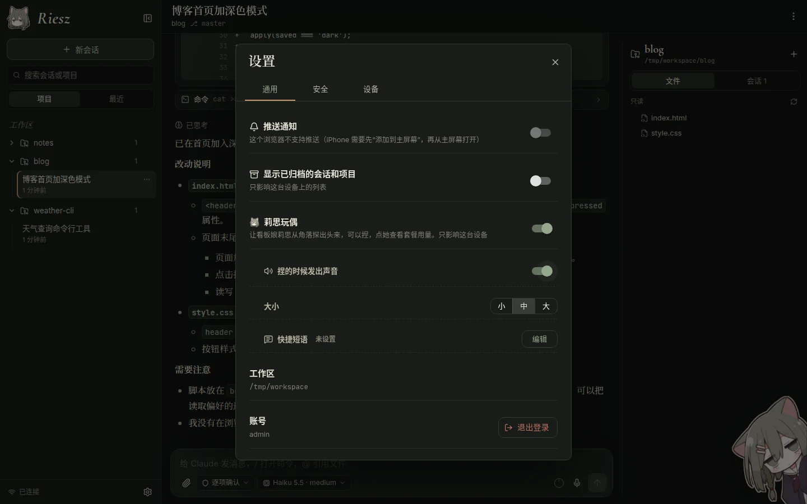

### 开启方法

1. 点击左边栏左下角的齿轮按钮（手机上先向右滑出会话列表），在「设置 → 通用 → 推送通知」打开开关。
2. 浏览器会请求通知权限，允许后可以点击「发送测试通知」测试是否正常收到。
3. 每台设备需要各自打开一次推送开关。

### 推送触发条件与规则

- **会推送的事件**：
  - Claude 等你确认：通知标题为「等你确认 · 会话名」，内容如「运行命令：npm test」。
  - Claude 向你提问：通知标题为「Claude 有问题问你 · 会话名」，内容是问题本身。
  - 长任务完成：运行超过 1 分钟的任务完成时推送「任务完成 · 会话名」，内容包含用时和最后回复的开头（终端里运行的会话也会触发）。
  - 异常退出：会话进程意外退出时推送「会话中断 · 会话名」。
- **免打扰与跳转**：点击通知会直接打开对应的会话。你在任何一台设备上正在查看的会话不会发送推送；同一会话连续出现多个确认时只提醒一次。

### 平台要求与排障

- 推送内容是端到端加密的，通过浏览器厂商的推送服务送达：
  - **Android（Chrome）**：走 Google 推送服务，需要手机能连上 Google 服务。部分国产安卓系统还需要在系统设置里允许 Chrome 后台运行和发送通知。
  - **iPhone**：需要 iOS 16.4 以上版本，并且需要先将网页添加到主屏幕、从主屏幕打开应用。
- 如果界面显示「通知权限被拒绝了」，请在浏览器的网站设置里重新允许通知权限。

## 使用莉思玩偶

看板娘「莉思」是项目的吉祥物。你可以在「设置 → 通用 → 莉思玩偶」中打开玩偶功能（默认关闭，该开关只影响当前设备），并可设置「捏的时候发出声音」以及玩偶大小（小 / 中 / 大）。

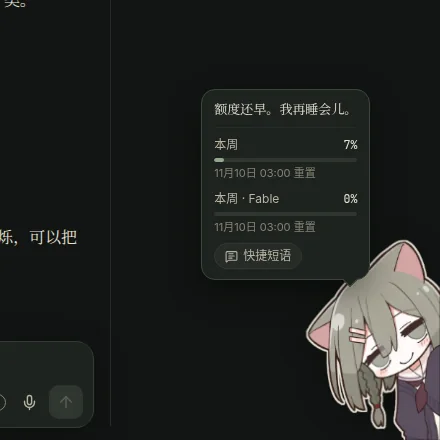

### 位置与互动

- **在电脑上**：莉思从屏幕右下角探出半身，你可以把她拖到左下角。当输入框伸展到她所在的角落时，她会自动站到输入框上方。
- **在手机上**：平时只在屏幕边缘露出半个头；点一下她会完整探出来并弹出气泡。你可以沿屏幕边缘上下拖动她，拖过屏幕中线会换到另一侧；当你打字时她会自动藏起来。
- **捏一捏**：按住莉思可以捏她（会压扁回弹，并发出“啾”的一声；电脑上会换成被捏的表情，手机上每次点出来会随机换一个表情）。
- **状态与提醒**：莉思的表情会随状态变化——有会话在运行时托腮思考，一段时间没有会话运行会睡着（飘出 z），用量快满时显得着急。当有会话等你确认时，她头上会出现感叹号并提醒你，点击提醒里的会话名可直接跳过去；当套餐用量第一次超过 80% 和 95% 时，她也会主动提醒。
- **右键 / 长按菜单**：在电脑上右键点击（手机上长按）莉思，可以快速开关声音、调整大小、打开「快捷短语」、「刷新用量」或「收起莉思」。

### 查看用量与使用快捷短语

点击莉思会弹出气泡，提供以下两个功能：

- **订阅额度窗口**：显示 Claude 订阅套餐各个额度窗口（如「本周」）的已用百分比和重置时间。该数据来自 Claude Code 自身的 `/usage` 命令，不会消耗额度。
- **「快捷短语」**：列出你保存的常用短语，点击一条就会填进当前的输入框（插入在光标处，或者在已有内容后另起一行）。你可以在「设置 → 通用 → 莉思玩偶 → 快捷短语」里点击「编辑」来添加多行短语或调整顺序；快捷短语保存在服务器上，所有设备共用。

## 在手机上使用

RieszManager 针对手机屏幕做了手势与布局适配，并支持安装为应用（PWA）。

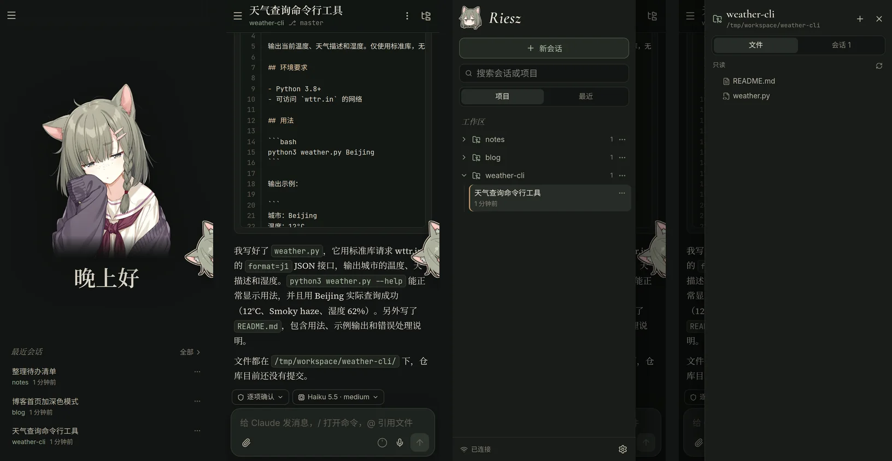

- **滑动手势**：在屏幕任意位置向右滑打开会话列表，向左滑打开项目面板；当有抽屉打开时，往回滑会先关闭抽屉。从代码块等可以横向滚动的区域开始滑动，不会误触发抽屉。
- **返回键与返回手势**：当有窗口打开时（如设置、文件预览、菜单、抽屉等），按返回会先关闭最上面的窗口；没有任何窗口时才会返回上一页。
- **界面布局**：手机首页显示最近的 3 个会话，点击「全部」打开完整的会话列表。对话页中，权限模式和模型按钮位于输入框上方，发送按钮固定在最右边。
- **安装成应用**：
  - **Android**：在「设置 → 通用」中点击「安装」（或使用浏览器菜单里的“添加到主屏幕 / 安装应用”）。
  - **iPhone**：使用 Safari 浏览器的分享菜单，选择“添加到主屏幕”。
- **自动更新**：当服务器部署新版本后，将应用从后台切回来时会自动刷新到新版本；如果你当时正在打字，界面会提示「有新版本」，等下次切到后台时再完成更新。

## 设置与账号安全

点击左边栏左下角的齿轮按钮打开设置窗口，里面包含三个标签：

- **「通用」**：配置「推送通知」、「显示已归档的会话和项目」、「莉思玩偶」、（可安装时）「安装应用」，查看当前工作区路径和登录账号，以及点击「退出登录」。
- **「安全」**：管理两步验证。
  - **启用**：点击「开始设置」，用验证器扫描二维码（或手动输入密钥），输入 6 位验证码点击「启用」；随后会显示 8 个恢复码，请务必妥善保存。
  - **管理**：已启用时，可以点击「重新生成恢复码」或「关闭两步验证」（需要输入当前验证码或一个恢复码；如果部署者配置了强制要求启用两步验证，则不能关闭）。
- **「设备」**：查看「已登录的设备」列表（显示浏览器、系统、IP、最近活动时间），你可以让某一台其他设备退出，或点击「退出其他所有设备」；列表下方还会显示「最近的登录尝试」。

如果丢失了验证器且没有恢复码，可以联系部署者在服务器上执行 `./rieszctl reset-totp` 关闭两步验证；部署者也可以执行 `./rieszctl revoke-sessions` 让所有已登录设备重新登录。

## 快捷键汇总

| 快捷键 | 使用场景 | 功能说明 |
| :--- | :--- | :--- |
| 回车 | 输入框（电脑端） | 发送消息；在命令或文件列表中为确认选择 |
| Shift+回车 | 输入框（电脑端） | 换行 |
| Esc | 对话页 / 弹出列表 | 中断当前任务并发送排队的消息（仅限网页里运行的会话）；在命令或文件列表中为关闭列表 |
| Shift+Tab | 对话页 | 依次切换权限模式 |
| `/` | 输入框 | 打开斜杠命令列表 |
| `@` | 输入框 | 打开文件列表以引用项目文件 |
| ↑ / ↓ | 输入框 | 光标在最开头时按 ↑ 调出历史输入，光标在最末尾时按 ↓ 往回翻 |
| ↑ / ↓（或 Ctrl+P / Ctrl+N） | 命令或文件列表 | 上下选择列表项 |
| Tab | 命令或文件列表 | 补全选中的命令或文件路径 |

## 常见问题

**页面提示「宿主机运行器未连接」怎么办？**
说明服务器上的 runner 没有运行，请联系部署者检查运行状态（在服务器上执行 `./rieszctl runner status`）。

**为什么我的终端会话突然退出了？**
当你给空闲的终端会话发消息时，该会话会自动转到网页里继续，终端里原有的进程就会退出。如果想回到终端继续使用，可以在网页的会话菜单里点击「复制终端恢复命令」拿到 `claude --resume` 命令。

**网页里的会话后台进程一直开着吗？**
网页里的会话长时间空闲后，后台的 `claude` 进程会自动结束以节省服务器资源；下次你再发消息时它会自动恢复，不影响对话。

**为什么语音按钮不能用？**
首先，麦克风只能在 HTTPS 页面下使用；其次，当部署者没有配置服务器转写接口时，语音输入依赖浏览器自带的语音识别，部分浏览器不支持此功能。

**为什么收不到推送通知？**
请先确认「设置 → 通用 → 推送通知」开关已打开，并点击「发送测试通知」看能否收到。如果在安卓手机上收不到，需要确保手机能连接 Google 服务，并在系统设置中允许浏览器后台运行和发送通知。
